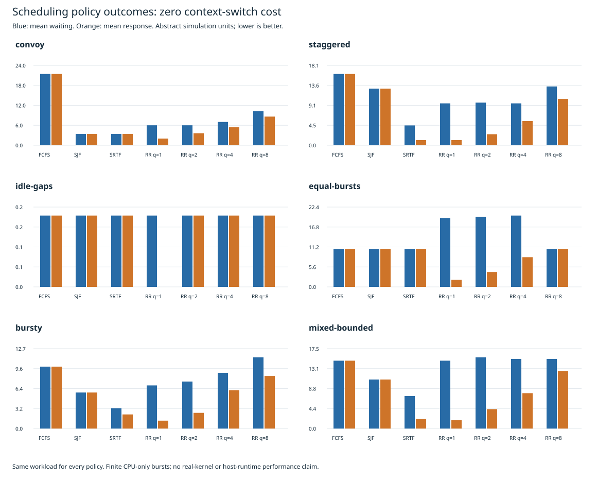
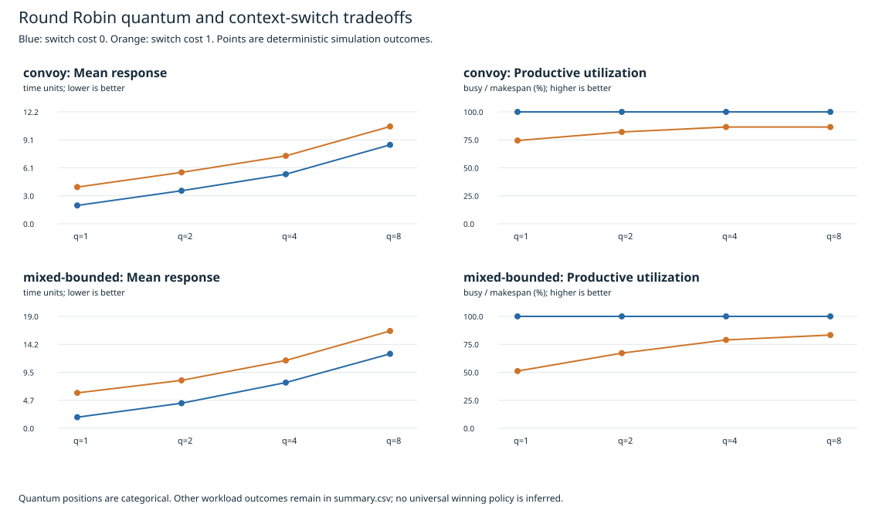
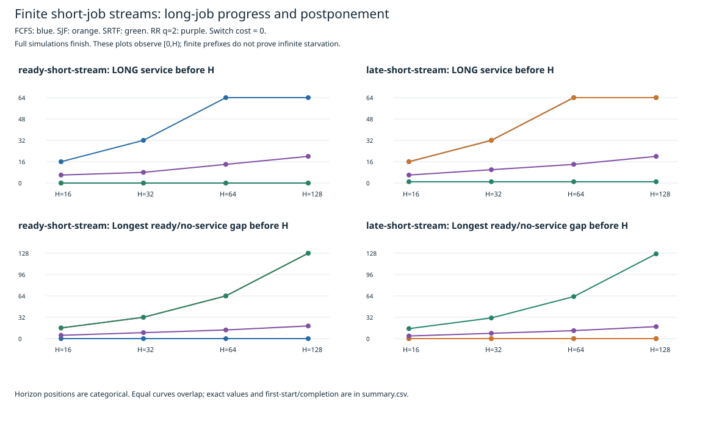

# Recorded Scheduling Policy Study — 2026-10-31

This directory contains **116 actual executions** of the C11 simulator on fixed synthetic inputs, followed by validated metric extraction. These are deterministic scheduling outcomes in abstract time, not wall-clock benchmarks or measurements of a real operating-system scheduler.

Read [Scheduling Case Studies](../../../docs/scheduling-analysis.md) for assumptions, four-policy behavior, convoy/preemption cases, RR quantum/context-cost tradeoffs, finite postponement and conditional policy-selection criteria.

## Scope

| Cohort | Workloads | Configurations | Switch costs | Cases |
| --- | ---: | --- | --- | ---: |
| Base policy comparisons | 6 | FCFS/SJF/SRTF; RR q=1/2/4/8 | 0, 1 | 84 |
| Finite-prefix studies | 2 families × 4 horizons | FCFS/SJF/SRTF/RR q=2 | 0 | 32 |

There are four algorithms; the base cohort has seven configurations because RR is measured at four quantum values. The quantum argument supplied to the other three policies is ignored by their scheduling rules.

## Recorded Environment and Validation

- Host: Darwin arm64; Homebrew Clang 23.1.4, Python 3.15.1.
- CLI build: C11, `-O2 -Wall -Wextra -Wpedantic -Werror`; the exact compiler argv and version are retained in metadata. The executable was built in a temporary directory and is not committed.
- The engine, CLI and public-header bytes match source commit `9bba2d6`. The experiment tools, import-safe tick oracle and workloads are recorded in feature commit `54f70f9f576006af1087bfb3b0a342e587963f20` and have their own captured hashes; the new experiment scripts did not exist at the older engine checkpoint.
- All 116 CLI commands exited zero with empty stderr. All timelines account for exact task service, arrivals, first/last service, waiting/turnaround/response, idle and context-switch costs.
- **74 zero-cost cases** match the independently written integer-tick oracle. Nonzero cost is covered by accounting and hand-derived tests, not an independent tick oracle.
- Four hand-workload policies give distinct checked completion outcomes; 14 experiment-tool/integration tests pass. Existing C/CLI/oracle checks and CMake/CTest are documented in [validation](../../../docs/validation.md).
- Summary JSON/CSV and three SVGs regenerate byte for byte after raw-data validation. SVG XML/geometry were checked; rendered visual QA was not available in the review environment.

## Files

- [metadata.json](metadata.json): complete status, exact workload CSV snapshots, source/workload/binary digests, compiler and command records.
- [records.json](records.json): per-task metrics, full Gantt timelines and finite-prefix observations for all 116 configurations.
- [raw/](raw/): stdout/stderr files from each invocation.
- [summary.csv](analysis/summary.csv) and [summary.json](analysis/summary.json): precise metric values computed from integer process metrics, rather than rounded console averages.

## Interpretation Limits

The finite-prefix cohort runs all jobs to completion; [0,H) is a separate observation window derived from those timelines. No finite result proves infinite starvation. The report distinguishes recorded long-job postponement from a conditional conceptual continuation with an unbounded stream. All prefix-cohort makespans equal H+64 at zero switch cost, so no throughput winner is inferred there.

The model has exact known ready-job burst lengths, one CPU, no I/O and no priority aging. Switch cost is an abstract parameter. These workloads are controlled constructions, not representative production traces. First response, total waiting, continued progress and dispatch overhead can favor different choices. No automatic policy selector or universal ranking is implemented.

Preserve this directory. For a fresh execution or a new derived-output directory, use [the reproduction commands](../../README.md).
